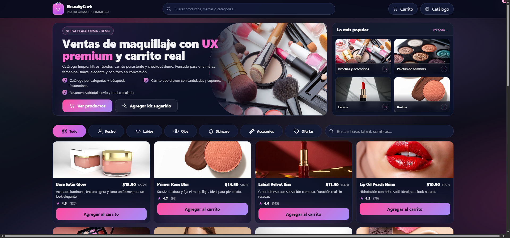

# Tienda de maquillaje · BeautyCart (demo)

**Diseño y desarrollo: Xioleni Salazar** · [Portafolio](https://xioleni.com/)

[Abrir la demo](https://xioleni.com/proyectos/plataforma-maquillaje/)\n\n

## Descripción del proyecto

Plataforma e-commerce de maquillaje con catálogo, filtros, búsqueda y carrito persistente. La demo presenta un recorrido de compra sencillo: explorar productos, encontrarlos por categoría o búsqueda y revisar el pedido desde un carrito lateral.

## Ficha del proyecto

- **Tipo:** e-commerce de demostración con carrito.
- **Código:** HTML · CSS · JavaScript.
- **Dificultad:** Media.
- **Enfoque:** catálogo rápido, fricción mínima durante la compra y una interfaz femenina premium.

## Qué incluye

- Catálogo organizado por categorías y búsqueda instantánea.
- Carrito tipo drawer con actualización de cantidades.
- Cupones de demostración y cálculo de subtotal, envío y total.
- Persistencia del carrito mediante `localStorage`.
- Diseño adaptable a pantallas de escritorio y móviles.

## Alcance de la demo

Productos, precios y cupones son ilustrativos. El carrito sirve para demostrar la interacción y persistencia en el navegador; no procesa pagos ni realiza pedidos reales.

## Ejecutar localmente

Abre `index.html` en un navegador o sirve la carpeta con `py -m http.server 8000`; luego visita `http://localhost:8000`.

## Créditos

Diseño e implementación de **Xioleni Salazar**.

## Presentaci&oacute;n r&aacute;pida

Tienda de maquillaje: cat&aacute;logo visual, b&uacute;squeda, filtros y carrito persistente.

**Demo:** consulta el enlace indicado arriba. **C&oacute;digo:** abre este repositorio. Las capturas muestran el proyecto local tal como est&aacute; en este c&oacute;digo.

## Decisiones y validaci&oacute;n manual

Al explorar, comprueba el filtro por categor&iacute;a y b&uacute;squeda; agrega un art&iacute;culo, cambia su cantidad, refresca la p&aacute;gina para revisar la persistencia y prueba un cup&oacute;n demo. Los importes y el flujo no procesan pagos reales.

Este repositorio no incluye una suite de pruebas automatizadas. La lista anterior sirve como comprobaci&oacute;n manual de la demo; no se presenta como un resultado de pruebas autom&aacute;ticas.

## Aporte y alcance

Dise&ntilde;o e implementaci&oacute;n de portafolio por Xioleni Salazar. El proyecto demuestra decisiones de interfaz y comportamiento frontend en una demo; no representa una tienda en producci&oacute;n ni trabajo para un cliente.
